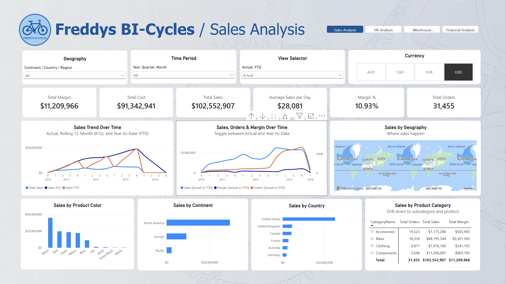
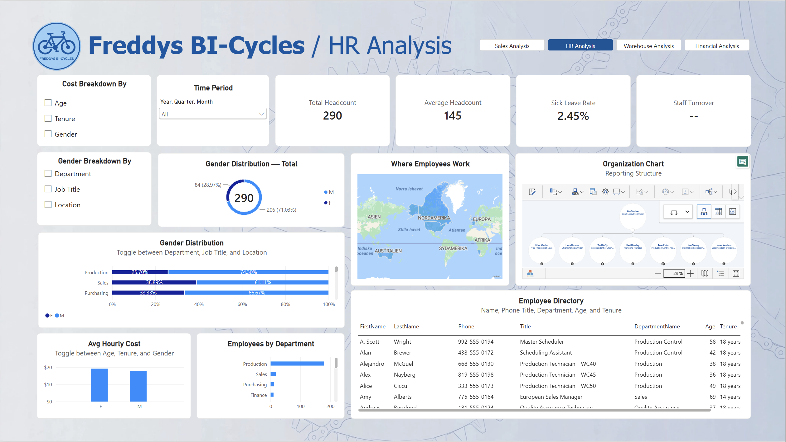
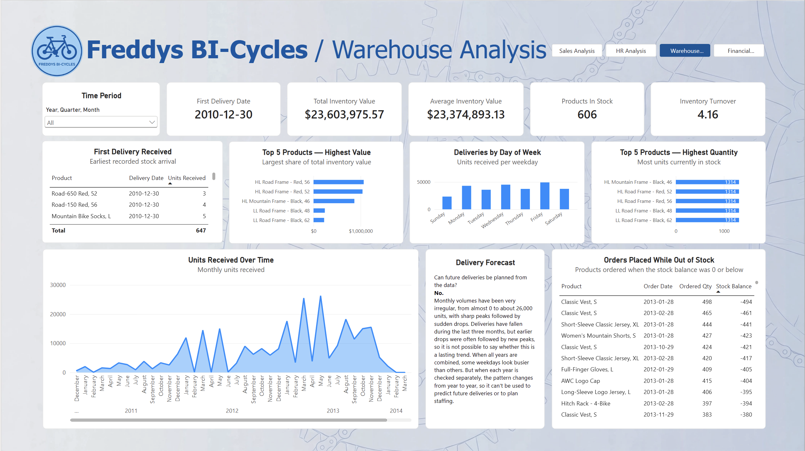
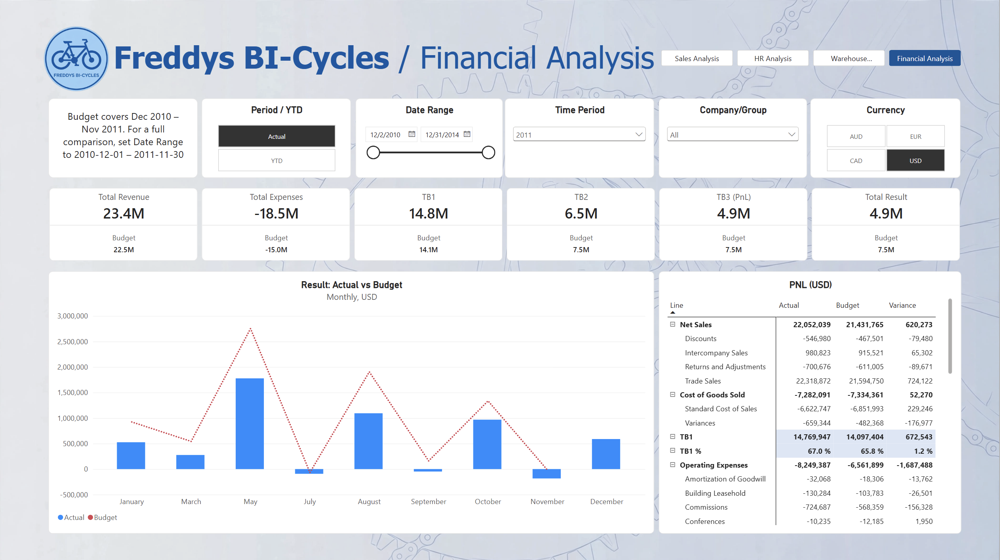
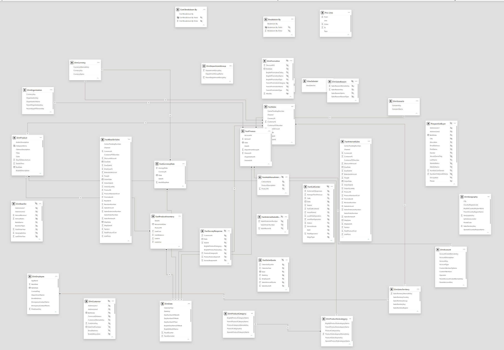

  

<h1 align="center">🚲 Freddys BI-Cycles</h1>

<i>A four-page Power BI report on sales, HR, warehouse and finance, built on the AdventureWorks data warehouse</i>

  
  
  
  
  

## 📌 The brief

Freddys BI-Cycles is a fictional bike manufacturer and retailer selling worldwide. Management wanted one report to follow up the whole business: **sales**, **staff**, **warehouse** and **finance**, with the option to view figures in **USD, EUR, CAD or AUD**.

I built it as one connected report with a shared design and navigation buttons, so users can move between departments like in an app.

---

## 💰 Sales Analysis

**Highlights**
- KPIs: total sales, cost, margin, margin %, orders and average sales per day
- Sales trend with **Actual, Rolling 12 months (R12) and YTD**
- A **view selector** that switches charts between Actual and YTD
- Sales by geography (map, continent, country), product colour and category, with drill-down to subcategory and product
- **Currency switch** (USD / EUR / CAD / AUD) using daily exchange rates

**Key findings**
- Total sales of **$102.6M** with a margin of **10.9%**.
- **Bikes** bring in about **86% of sales** but have a margin of only around 11%. **Accessories** are small in volume but have a margin of about **50%**, which makes them an interesting growth area.
- **North America**, and the **United States** in particular, is by far the biggest market.

---

## 👥 HR Analysis

**Highlights**
- KPIs: total and average headcount and sick leave rate
- **Field parameters** let the user switch the gender chart between department, job title and location, and the cost chart between age, tenure and gender
- Map of where employees work, an **organisation chart** and a searchable employee directory

**Key findings**
- The workforce is **71% men**, and the gap is biggest in **Production**, the largest department.
- Sick leave is low at **2.45%**.

---

## 📦 Warehouse Analysis

**Highlights**
- KPIs: total and average inventory value, products in stock and inventory turnover
- Top 5 products by stock value and by quantity, deliveries per weekday and units received over time
- A table of **orders placed while the product was out of stock**

**Key findings**
- Inventory is worth about **$23.6M**, with a turnover of **4.16**.
- Several products, like *Classic Vest S*, were ordered while the stock balance was **below zero**, a sign of planning problems in the warehouse.
- **Can future deliveries be predicted? No.** Monthly volumes swing from almost 0 to about 26,000 units, and weekday patterns change from year to year, so the data can't be used for staffing or delivery planning.

---

## 📈 Financial Analysis

**Highlights**
- **Actual vs. budget** for revenue, expenses, gross margin levels (TB1, TB2, TB3) and result
- A full **P&L** with actual, budget and variance per line, built from a custom P&L line table
- Switches for **period vs. YTD**, date range, company and currency

**Key findings**
- Sales beat the budget (**$23.4M vs. $22.5M**), and the gross margin was better than planned (**67.0% vs. 65.8%**).
- Still, the result ended at **$4.9M vs. a $7.5M budget**, because **operating expenses** were about **$1.7M over budget**. The problem is costs, not sales.

---

## 🛠️ How it was built

The model is built on the **AdventureWorks data warehouse** with several fact tables sharing common dimensions:

- **Facts:** internet and reseller sales, finance, product inventory and currency rates
- **Dimensions:** date, product (with category and subcategory), sales territory, geography, employee, currency, organisation, account and scenario (actual / budget)
- **Helper tables:** field parameters for the dynamic charts and a P&L line table that controls the order and subtotals of the income statement

**DAX** measures cover margin and margin %, YTD and rolling 12 months, currency conversion, budget vs. actual variance, headcount, sick leave rate, inventory value and turnover.

---

<i>Built by <a href="https://github.com/ErikBenalcazar">Erik Benalcazar Lopez</a> · Business Intelligence Analytics student at Nackademin</i>

